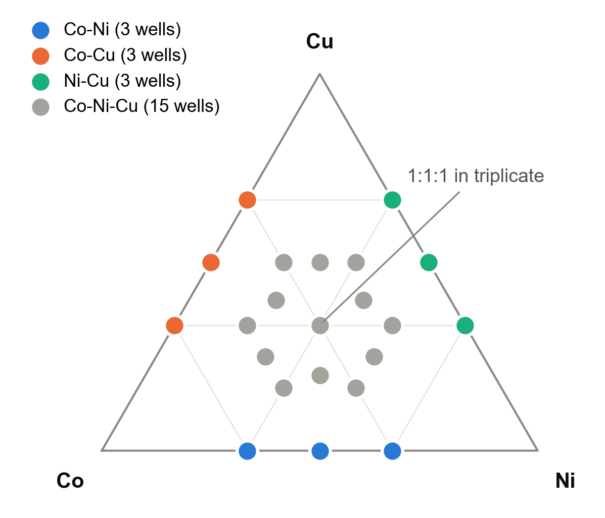

# Exploring Heterometallic Co–Ni–Cu Benzenedicarboxylate Coordination Polymers via Automated Ternary Gradient Synthesis

Project M3-MOF by team MOFKeKing, SDL Hackathon 2026.

A 96-reaction composition screen of cobalt, nickel and copper with 1,4-benzenedicarboxylic acid (BDC), dispensed on an Opentrons OT-2 and screened by UV–Vis at the SDL Hackathon (UZH HTEL, 26–30 October 2026).

Team: Aritra Roy, Piyush Ranjan Maharana, Tarak Nath Das.

<p align="center">
  
</p>

## What we did

- **Design:** 24 Co:Ni:Cu compositions (9 binary, 15 ternary including a 1:1:1 triplicate), each at four metal : ligand ratios (1:1 to 1:4). That gives 96 reactions of 300 µL in DMF with 18 mM total metal.
- **Dispensing:** the OT-2 (P20 + P300) adds the DMF top-up, Co, Ni and Cu first and BDC last, so all reactions start within one short step: 420 transfers using 8 tips.
- **Reaction and screening:** 13 h at 120 °C in capped 2 mL GC vials, then UV–Vis from 400 to 900 nm on every vial.
- **Analysis:** second-derivative spectra separate absorption bands from scattering by the solid. A binary-reconstruction test then checks whether any ternary spectrum contains a feature that no mixture of binary spectra can reproduce.

HPLC–MS and PXRD on the leads are the next step; HPLC–MS results are not available yet.

## Main results (UV–Vis)

- **Copper drives solid formation.** Co–Ni wells scatter least at every ligand ratio.
- **~700 nm band (Cu(II) d–d):** present in every Cu-containing well.
- **~590 nm band:** appears only with Co + Cu.
- **~420 nm band:** appears only with Ni + Cu.

The 590 nm and 420 nm bands are bimetallic signatures. No ternary well shows a feature beyond what the binary wells explain: 0/60 ternaries exceed the binary null distribution.

The write-ups are [submission/M3-MOF_Project_Description.pdf](submission/M3-MOF_Project_Description.pdf) (what was and was not executed, results) and [submission/M3-MOF_Workflow_Summary.pdf](submission/M3-MOF_Workflow_Summary.pdf). The talk is [submission/M3-MOF_Presentation.pptx](submission/M3-MOF_Presentation.pptx).

## Repository layout

| Path | Contents |
|---|---|
| `generate_plate.py` | Plate design, per-vial volumes and stock preparation (writes the three CSVs) |
| `build_plate_workbook.py` | Excel calculator `plate_plan_96wells.xlsx` (ratios → mM → µL, live formulas) |
| `ot2_protocol.py` | OT-2 protocol (API 2.27) with the per-vial volumes built in |
| `labware/` | HTEL Axygen 12-well reservoir definition used by the protocol |
| `data/` | Raw Tecan UV–Vis export and organiser comments |
| `analysis/analyse_uvvis.py` | Full UV–Vis analysis; writes CSVs and figures to `analysis/output/` |
| `analysis/output/well_metrics.csv` | Per-well composition, scattering, band strengths, peak-to-noise and flags |
| `build_reports.py` | Builds the two submission PDFs in `submission/` |

## Reproducing the analysis

```bash
pip install numpy pandas scipy matplotlib openpyxl
python generate_plate.py
python analysis/analyse_uvvis.py
```

The reports also need `reportlab` (`python build_reports.py`). To simulate the OT-2 protocol, use `opentrons<9`: `opentrons_simulate -L labware ot2_protocol.py`.

## Team MOFKeKing

| Member | Email | Links |
|---|---|---|
| Aritra Roy | [contact@aritraroy.live](mailto:contact@aritraroy.live) | 🌐: [aritraroy.live](https://aritraroy.live), 🐙: [@aritraroy24](https://github.com/aritraroy24) |
| Piyush Ranjan Maharana | [piyushmaharana15@gmail.com](mailto:piyushmaharana15@gmail.com) | 🌐: [catastropiyush.github.io](https://catastropiyush.github.io), 🐙: [@catastropiyush](https://github.com/catastropiyush) |
| Tarak Nath Das | [dastaraknath4@gmail.com](mailto:dastaraknath4@gmail.com) | [LinkedIn](https://www.linkedin.com/in/tarak-nath-das-4362251b7/) |

Thanks to the UZH HTEL team for running the OT-2, oven and UV–Vis steps.

## AI assistance

We used Claude Opus 5.5 (Anthropic) to help with the plate design calculations, the OT-2 protocol, the UV–Vis analysis code and figures, the submission reports and the presentation. The team reviewed and checked all of its output.
